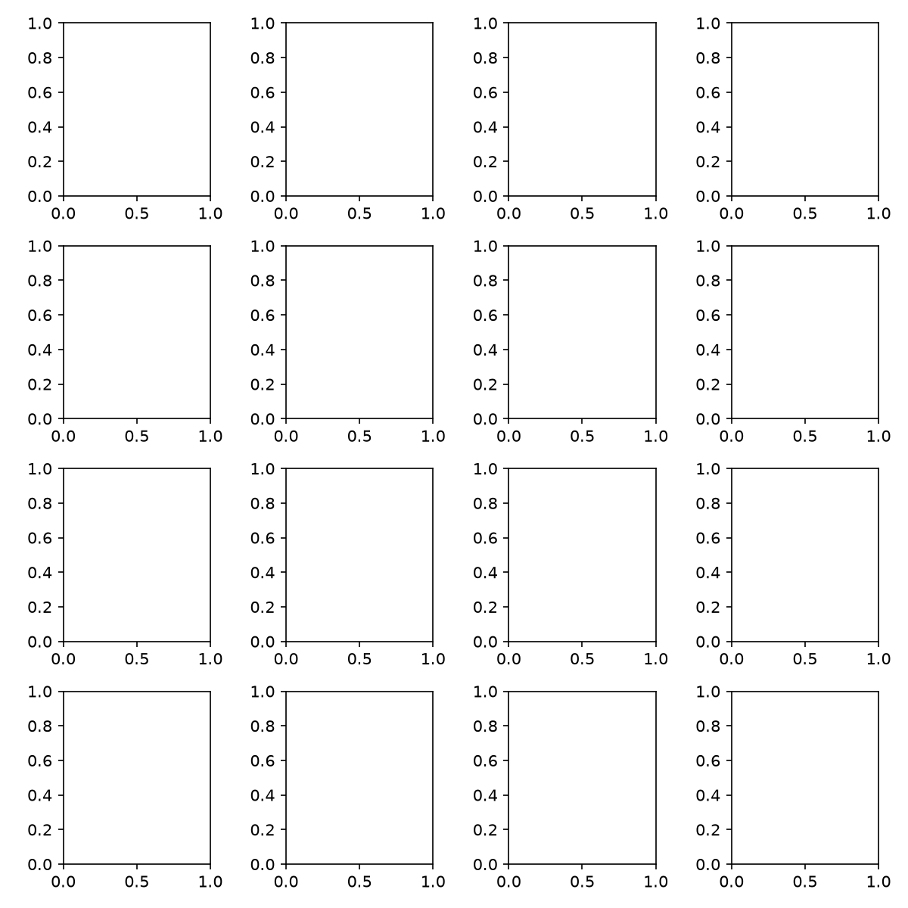
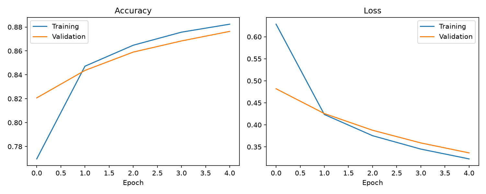

# Derin Öğrenme ve Evrişimsel Sinir Ağlarının (CNN) Temel Yapısının İncelenmesi

* **Öğrenci:** Sinan Kapağan
* **Öğrenci No:** 02230224042
* **Bölüm:** Yazılım Mühendisliği
* **Kullanılan Teknolojiler:** Python, TensorFlow / Keras, NumPy, Matplotlib
* **Veri Seti:** Fashion-MNIST

---

## 1. Kurulum ve Çalıştırma

```bash
pip install tensorflow numpy matplotlib
python derin_ogrenme.py
```

---

## 2. Bölüm: Temel Kavramların İncelenmesi

### Soru 1: Derin Öğrenme Nedir?
* **Makine öğrenmesi ile derin öğrenme arasındaki fark nedir?**
  Klasik makine öğrenmesinde verideki ayırt edici özelliklerin (kenar, doku, şekil vb.) insan uzmanlar tarafından elle çıkarılması (feature engineering) gerekir. Derin öğrenme ise çok katmanlı yapay sinir ağları kullanarak ham veriden bu özellikleri hiyerarşik biçimde otomatik olarak öğrenir.
* **Yapay sinir ağları nasıl çalışır?**
  Giriş verilerini her bağlantıya ait ağırlıklarla (weight) çarpar, üzerine sapma değeri (bias) ekler ve sonucu doğrusal olmayan bir aktivasyon fonksiyonundan geçirerek sonraki katmana iletir. Eğitim sırasında tahmin ile gerçek etiket arasındaki hata (loss) hesaplanır ve geri yayılım (backpropagation) algoritmasıyla ağırlıklar güncellenir.
* **Bir yapay sinir ağı neden birden fazla katmandan oluşur?**
  Tek katmanlı ağlar yalnızca doğrusal olarak ayrılabilen basit problemleri çözebilir. Çok katmanlı yapı sayesinde ilk katmanlar çizgi ve kenar gibi temel detayları, orta katmanlar şekilleri, son katmanlar ise nesnenin bütününü öğrenerek karmaşık örüntüleri sınıflandırabilir.

### Soru 2: Konvolüsyon Nedir?
* **Konvolüsyon işlemi görüntü üzerinde nasıl gerçekleştirilir?**
  Küçük boyutlu bir ağırlık matrisinin (filtre), giriş görüntüsünün piksel matrisi üzerinde sol üst köşeden başlayarak belirli adımlarla (stride) kaydırılması ve örtüşen elemanların çarpılıp toplanmasıyla özellik haritası (feature map) üretilir.
* **Kernel (filtre) nedir?**
  Görüntüdeki dikey kenar, yatay kenar, köşe veya doku gibi belirli bir görsel deseni tespit etmek amacıyla kullanılan ve değerleri eğitim sırasında öğrenilen küçük matristir.
* **3×3 boyutundaki bir filtrenin kaç ağırlık parametresi vardır?**
  $3 \times 3 = 9$ adet ağırlık (weight) parametresi vardır (filtre başına 1 bias değeriyle birlikte toplam 10 öğrenilebilir parametre bulunur).
* **Filtre görüntü üzerinde hareket ederken ne yapar?**
  Üzerinde bulunduğu bölgedeki piksel değerleriyle kendi ağırlıklarını çarparak toplar; aradığı görsel desen o bölgede mevcutsa yüksek, değilse düşük bir aktivasyon değeri üretir.
* **Bir CNN'de neden birden fazla filtre kullanılır?**
  Tek bir filtre yalnızca tek bir özelliği (örneğin sadece yatay kenarları) algılayabilir. Görüntünün tamamını anlamlandırabilmek için farklı yönlerdeki kenarları, dokuları ve şekilleri aynı anda yakalayacak çok sayıda filtre kullanılır.

### Soru 3: Pooling Nedir?
* **Max Pooling işleminin amacı nedir?**
  Özellik haritalarının boyutunu küçülterek hesaplama maliyetini ve parametre sayısını azaltmak, aşırı öğrenmeyi (overfitting) önlemek ve en baskın özellikleri koruyarak küçük kaymalara karşı dayanıklılık sağlamaktır.
* **2×2 Max Pooling nasıl çalışır?**
  Özellik haritasını $2 \times 2$ boyutunda bölgelere ayırır ve her bölgedeki 4 değer arasından en büyüğünü seçip diğerlerini eler.
* **Giriş görüntüsünün boyutunu nasıl değiştirir?**
  Adım (stride) değeri 2 olduğunda görüntünün yüksekliğini ve genişliğini yarıya indirir ($H \times W \rightarrow \frac{H}{2} \times \frac{W}{2}$), kanal sayısını değiştirmez.

### Soru 4: Aktivasyon Fonksiyonları
* **Aktivasyon fonksiyonları neden kullanılır?**
  Ağa doğrusal olmama (non-linearity) özelliği kazandırmak için kullanılır. Aktivasyon fonksiyonu olmasaydı çok katmanlı bir ağ tek bir doğrusal dönüşüme indirgenir ve karmaşık problemleri öğrenemezdi.
* **ReLU fonksiyonu nasıl çalışır?**
  $f(x) = \max(0, x)$ kuralıyla çalışır; negatif değerleri sıfıra eşitler, pozitif değerleri olduğu gibi geçirir.
* **Softmax fonksiyonu ne işe yarar?**
  Çok sınıflı sınıflandırmada son katmandan çıkan ham skorları (logits), her biri $[0, 1]$ aralığında yer alan ve toplamı $1$ olan olasılık dağılımına dönüştürür.
* **ReLU ile Softmax arasındaki temel fark nedir?**
  ReLU gizli katmanlarda kullanılır ve her nöronu bağımsız değerlendirir; Softmax ise çıkış katmanında kullanılır ve tüm sınıfların skorlarını birbirine oranlayarak olasılık üretir.

### Soru 5: Dense Katman
* **Dense katman nedir?**
  Bir katmandaki tüm nöronların bir önceki katmandaki tüm nöronlarla doğrudan bağlı olduğu tam bağlantılı (Fully Connected) sinir ağı katmanıdır.
* **Flatten katmanının görevi nedir?**
  Konvolüsyon ve Pooling katmanlarından gelen çok boyutlu matris verisini, Dense katmanların işleyebilmesi için tek boyutlu vektöre dönüştürür.
* **CNN mimarisinde Dense katmanlar neden kullanılır?**
  Konvolüsyon katmanlarının görüntüden çıkardığı görsel özellikleri birleştirip yorumlayarak nihai sınıflandırma kararını vermek için kullanılır.

---

## 3. Bölüm: Konvolüsyon İşleminin İncelenmesi

1. **16 filtre ne anlama gelmektedir?** Giriş görüntüsü üzerinde 16 farklı özellik dedektörünün çalıştırılacağını ve çıkışta 16 adet özellik haritası üretileceğini gösterir.
2. **Her filtrenin boyutu nedir?** Giriş tek kanallı olduğu için $3 \times 3 \times 1$ boyutundadır.
3. **`weights` değişkeninin boyutu `(3, 3, 1, 16)`:** Sırasıyla filtre yüksekliği (`3`), filtre genişliği (`3`), giriş kanal sayısı (`1`) ve toplam filtre sayısını (`16`) ifade eder.
4. **`biases` değişkeninin boyutu `(16,)`:** 16 filtrenin her biri için 1 adet sapma (bias) değeri bulunduğunu gösterir.
5. **Çıkış boyutunun `126×126` olması:** Varsayılan olarak kenarlara sıfır ekleme (`padding='valid'`) yapılmadığı için $3 \times 3$'lük filtre kenarlardan 1'er piksel içeride kalır ($128 - 3 + 1 = 126$).
6. **`kernel_initializer='he_normal'`:** ReLU aktivasyon fonksiyonuyla uyumlu çalışması için başlangıç ağırlıklarının ortalaması $0$, standart sapması $\sqrt{2 / n_{in}}$ olan normal dağılımdan seçilmesini sağlar.
7. **Filtrelerin Görselleştirilmesi:**
   

---

## 4. Bölüm: Pooling İşleminin İncelenmesi

* **El İle Hesaplama ve Karşılaştırma:**
  * Sol Üst (`[1, 3, 5, 6]`) $\rightarrow$ **6**
  * Sağ Üst (`[2, 4, 1, 2]`) $\rightarrow$ **4**
  * Sol Alt (`[7, 2, 4, 1]`) $\rightarrow$ **7**
  * Sağ Alt (`[8, 3, 5, 9]`) $\rightarrow$ **9**
  Program çıktısı ile el hesabı birebir aynıdır (`[[6., 4.], [7., 9.]]`).
* **Boyut Değişimi:** `(1, 4, 4, 1)` olan giriş matrisi, $2 \times 2$ pencere ve `strides=2` ile `(1, 2, 2, 1)` boyutuna düşmüştür.
* **Avantajı:** Ekstra parametre eklemeden veri boyutunu %75 azaltır, eğitimi hızlandırır ve belirgin özellikleri korur.

---

## 5. Bölüm: ReLU ve Softmax İncelemesi

* **ReLU:** Negatif değerler sıfırlanarak gereksiz sinyaller bastırılır (seyreklik sağlanır); pozitif değerler korunarak derin ağlarda gradyan kaybolması önlenir. ReLU olmasaydı ağ doğrusal kalır ve karmaşık desenleri öğrenemezdi.
* **Softmax:** Çıktıdaki `[0.659, 0.242, 0.099]` değerleri girdinin her bir sınıfa ait olma olasılığını gösterir. Paydadaki normalizasyon nedeniyle toplamları daima `1.0`'dır. En yüksek olasılıklı sınıf `argmax` ile bulunur.

---

## 6. ve 7. Bölüm: Model Mimarisi ve Eğitim Grafikleri

1. **Konvolüsyon katmanı sayısı:** 2 adet `Conv2D` katmanı vardır.
2. **İlk katmanda 8 filtre:** Giriş görüntüsündeki temel kenar ve çizgi özelliklerini yakalamak için yeterlidir.
3. **İkinci katmanda 16 filtre:** İlk katmandan gelen temel özelliklerin kombinasyonuyla daha karmaşık şekilleri öğrenmek için artırılmıştır.
4. **Görüntü boyut değişimi:** `28×28` $\rightarrow$ Conv1 (`26×26`) $\rightarrow$ Pool1 (`13×13`) $\rightarrow$ Conv2 (`11×11`) $\rightarrow$ Pool2 (`5×5`).
5. **Pooling katkısı:** Boyutu yarıya indirerek parametre yükünü ve hesaplama süresini azaltmıştır.
6. **Flatten çıktısı:** $5 \times 5 \times 16 = 400$ elemanlıdır.
7. **Dense(64):** Gizli katmandaki 64 yapay sinir hücresini (nöronu) ifade eder.
8. **Son katmanda 10 nöron:** Fashion-MNIST veri setindeki 10 farklı giysi sınıfını temsil eder.
9. **Softmax en yüksek değer:** Modelin görüntüyü en yüksek ihtimalle ait gördüğü sınıfı ve güven oranını ifade eder.
10. **Başarı metriği:** Doğruluk (`accuracy`) metriği kullanılmıştır.



---

## 8. Bölüm: Deney Karşılaştırması

| Ölçüt | Deney 1 | Deney 2 |
| :--- | :---: | :---: |
| **Filtre sayısı** | 8 | 16 |
| **Eğitim doğruluğu** | %88.24 | %88.66 |
| **Test doğruluğu** | %87.27 | %87.61 |
| **Test kaybı (Loss)** | 0.3588 | 0.3531 |
| **Eğitim süresi** | 40.36 sn | 72.22 sn |

**Yorum:** İlk katmandaki filtre sayısını 8'den 16'ya çıkarmak modelin daha çeşitli temel özellikler öğrenmesini sağlayarak eğitim doğruluğunu `%88.24`'ten `%88.66`'ya, test doğruluğunu ise `%87.27`'den `%87.61`'e yükseltmiştir. Ancak işlem hacmi büyüdüğü için eğitim süresi `40.36` saniyeden `72.22` saniyeye (yaklaşık 1.8 katına) çıkmıştır. Daha fazla filtre kullanmak her zaman daha iyi sonuç vermez; gereğinden fazla filtre sayısı parametre yükünü artırarak modelin eğitim verisini ezberlemesine (overfitting) ve hesaplama maliyetinin verimsiz büyümesine neden olabilir.

---

## 9. Bölüm: Değerlendirme ve Sonuç

Bu ödev kapsamında Evrişimsel Sinir Ağlarının temel yapı taşları olan konvolüsyon, aktivasyon, havuzlama (pooling) ve tam bağlantılı katmanların veriyi nasıl işlediği uygulamalı olarak incelenmiştir. Katmanlar arası boyut dönüşümleri ve farklı filtre sayılarının model performansına etkisi deneysel olarak gözlemlenmiştir.

---

## 10. Uygulama Kodu (`derin_ogrenme.py`)

```python
import time
import matplotlib.pyplot as plt
import numpy as np
import tensorflow as tf

tf.keras.utils.set_random_seed(42)

# 3. BOLUM: KONVOLUSYON VE FILTRE GORSELLESTIRME
conv = tf.keras.layers.Conv2D(
    filters=16,
    kernel_size=(3, 3),
    activation='relu',
    kernel_initializer='he_normal'
)

dummy_input = tf.random.normal((1, 128, 128, 1))
output_conv = conv(dummy_input)
weights, biases = conv.get_weights()

print("--- 3. BOLUM: KONVOLUSYON ---")
print("Giris boyutu:", dummy_input.shape)
print("Cikis boyutu:", output_conv.shape)
print("Filtre agirliklarinin boyutu:", weights.shape)
print("Bias boyutu:", biases.shape)
print("Ilk filtre agirliklari:\n", weights[:, :, 0, 0])

plt.figure(figsize=(8, 8))
for i in range(16):
    plt.subplot(4, 4, i + 1)
    plt.imshow(weights[:, :, 0, i], cmap='viridis')
    plt.title(f'Filtre {i+1}')
    plt.axis('off')
plt.suptitle("16 Filtrenin Baslangic Agirliklari")
plt.tight_layout()
plt.savefig("filtreler.png", dpi=150)
plt.close()

# 4. BOLUM: MAX POOLING ISLEMI
input_data = tf.constant([
    [[1., 3., 2., 4.],
     [5., 6., 1., 2.],
     [7., 2., 8., 3.],
     [4., 1., 5., 9.]]
])
input_data = tf.reshape(input_data, (1, 4, 4, 1))

pool = tf.keras.layers.MaxPooling2D(pool_size=(2, 2), strides=2)
output_pool = pool(input_data)

print("\n--- 4. BOLUM: POOLING ---")
print("Giris:\n", input_data.numpy()[0, :, :, 0])
print("Pooling sonucu:\n", output_pool.numpy()[0, :, :, 0])

# 5. BOLUM: RELU VE SOFTMAX
x = tf.constant([-5., -2., -1., 0., 2., 4., 6.])
relu = tf.keras.layers.ReLU()
y = relu(x)

logits = tf.constant([[2.0, 1.0, 0.1]])
softmax = tf.keras.layers.Softmax()
probabilities = softmax(logits)

print("\n--- 5. BOLUM: RELU & SOFTMAX ---")
print("ReLU giris:", x.numpy())
print("ReLU cikis:", y.numpy())
print("Softmax sonuclari:", probabilities.numpy())
print("Olasiliklarin toplami:", tf.reduce_sum(probabilities).numpy())

# 6. VE 8. BOLUM: FASHION-MNIST CNN VE DENEYLER
(x_train, y_train), (x_test, y_test) = tf.keras.datasets.fashion_mnist.load_data()
x_train = x_train.astype("float32") / 255.0
x_test = x_test.astype("float32") / 255.0
x_train = x_train[..., np.newaxis]
x_test = x_test[..., np.newaxis]

def deney_calistir(filtre_sayisi):
    tf.keras.utils.set_random_seed(42)
    model = tf.keras.Sequential([
        tf.keras.layers.Input(shape=(28, 28, 1)),
        tf.keras.layers.Conv2D(filtre_sayisi, (3, 3), activation='relu'),
        tf.keras.layers.MaxPooling2D((2, 2)),
        tf.keras.layers.Conv2D(16, (3, 3), activation='relu'),
        tf.keras.layers.MaxPooling2D((2, 2)),
        tf.keras.layers.Flatten(),
        tf.keras.layers.Dense(64, activation='relu'),
        tf.keras.layers.Dense(10, activation='softmax')
    ])
